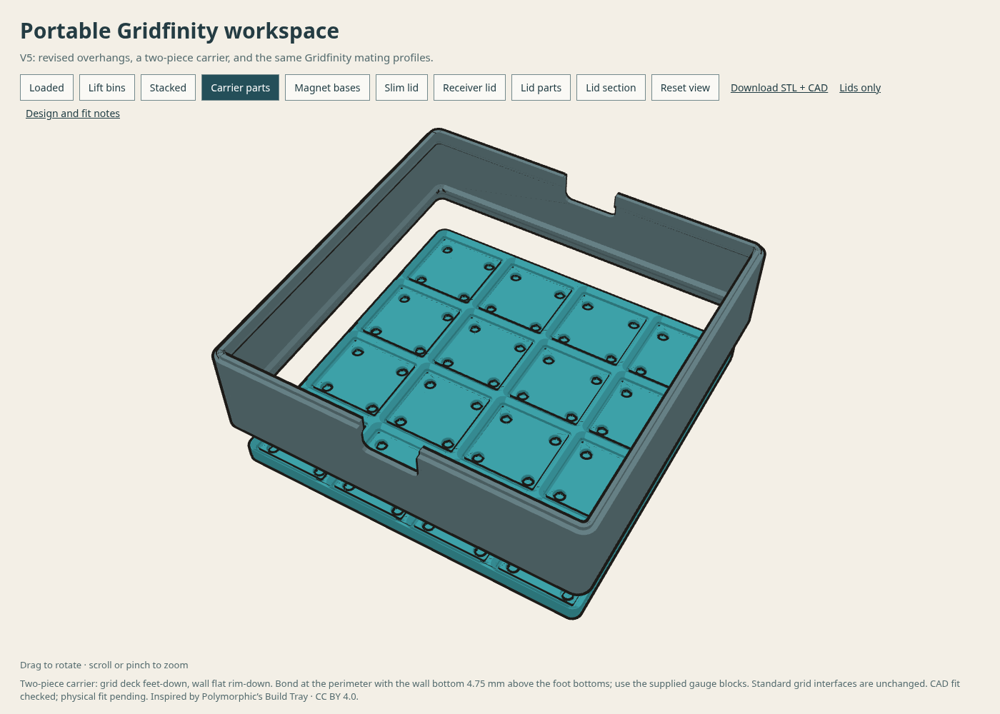

# Gridfinity build tray — V5

[Interactive preview](https://thereprocase.github.io/gridfinity-build-tray/) · [Full STL + CAD download](gridfinity-workspace-v5.zip) · [Lids only](gridfinity-lids-v5.zip)

A portable 4×4 Gridfinity carrier with magnetic bases, six bin layouts, stacking,
a slim lid, and a recessed Gridfinity receiver lid. The carrier is 176 mm square;
the standard grid pitch is 42 mm. The carrier prints as a separate grid deck and
carrying wall, bonded together with four optional alignment gauges.



V5 removes the unsupported carrier rim and abrupt receiver-lid ledges. The lid
parts meet on a continuous 45° taper. Longer internal bin shoulders improve their
rounded-corner slopes without changing the mating profiles. Eighty CAD comparisons
against V4 found zero changed volume in the protected feet, magnet pockets,
stacking receivers, carrier upper lip, and full 4×4 receiver regions.

**Physical validation is pending.** Standard magnet-pocket roofs and gaps between
Gridfinity feet still require bridging. The carrier's adhesive joint carries the
deck when lifting by the wall. Fit, bridge quality, adhesive strength and load
capacity have not been physically qualified. Neither lid is latched or sealed.

## Files and reproduction

- [Design, print orientation and assembly notes](README.txt).
- The full ZIP includes eleven printable STL/STEP pairs, alignment gauges,
  editable FreeCAD document, reference assemblies, generators and validation.
- [source/](source/) contains the editable FreeCAD generators and geometry checks.
- [validation.json](validation.json): solid/mesh validity, interference and seating.
- [interface-checks.json](interface-checks.json): V4-to-V5 protected-interface comparisons.
- [overhang-audit.json](overhang-audit.json): exported meshes in print orientations.
- [SLICE-NOTES.txt](SLICE-NOTES.txt) and [slice-results.json](slice-results.json):
  support-disabled comparison estimates and hashes of the sliced source meshes.
- [provenance.json](provenance.json): hashes of the archived downloads and CAD sources.

The generators use FreeCAD 1.1.3's Python environment (`FreeCAD`, `Part`,
`MeshPart`). Run `source/build.py`, then `source/build_lids.py`. They write
`models/`, `accessories/`, the editable document and reference assemblies beside
the scripts. In FreeCAD's Python console, run each script using:

```python
p = "/absolute/path/to/source/build.py"  # then build_lids.py
exec(compile(open(p).read(), p, "exec"), {"__file__": p})
```

Run `python source/audit_overhangs.py` after generation. The historical
`check_interfaces.py` additionally needs the V4 reference export in a sibling
`v4/` directory; its recorded results are provided here. Comparison slicing used
OrcaSlicer 2.5.0-dev with 0.4 mm nozzle, 0.20 mm layers, three walls, 15% gyroid
and saved Polymaker PETG profiles. No machine-specific G-code is published.

The web preview loads actual exported mesh geometry. Its section is a CAD cut;
it does not depict slicer infill. `public/gridfinity-build-tray/` is the source
page and `docs/gridfinity-build-tray/` is the committed Pages copy. Keep both in
sync; the normal site build copies public assets into the export. Gridline styles
come from the shared `gridline/` directory. This import changes page styling only;
the two release ZIPs retain their verified V5 bytes.

## Attribution and license

Remix of [Polymorphic's Build Tray: Modular organizer for assembly, disassembly
and maintenance](https://www.printables.com/model/1758185-build-tray-modular-organizer-for-assembly-disassem).
The original is CC BY 4.0. This remix changes the grid layout, geometry, stacking,
magnet bases and lids, and is also shared under
[Creative Commons Attribution 4.0](https://creativecommons.org/licenses/by/4.0/).
See [LICENSE.txt](LICENSE.txt). This license applies to this project, not to other
projects or shared assets elsewhere in this repository.
